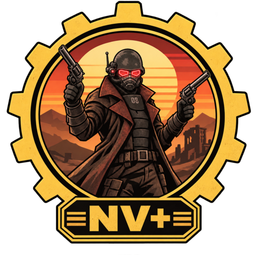

  

<h1 align="center"></h1>

**Fallout: New Vegas on the nv-rs engine, with extras: modern controls, its own launcher, and
multiplayer with dedicated servers.**

NV+ is a fork of [nv-rs](https://github.com/slaterain/nv-rs), slaterain's rebuild of Fallout: New
Vegas in Rust. nv-rs aims to play exactly like the original. NV+ keeps all of that and takes in
every upstream change as it lands (fixes, speed, built-in mod support for the original game's
mods), then adds features the original never had. Each addition is optional and switchable, so
the original way of playing stays available.

> [!IMPORTANT]
> NV+ is an independent project, not affiliated with or endorsed by Bethesda Softworks, ZeniMax
> Media, Obsidian Entertainment or Microsoft, and not an official part of nv-rs. It contains no
> game files; you need your own legally obtained copy of the game. See [LEGAL.md](../LEGAL.md).

## Where it stands

NV+ has just started. It runs everything nv-rs runs today, plus the changes in the
[changelog](CHANGELOG.md). There is no NV+ download yet; for now, build from source as nv-rs
describes in [docs/PLAYTESTING.md](../docs/PLAYTESTING.md).

| | What | Status |
|---|---|---|
| ✅ | **Everything in nv-rs** | Merged in from upstream as it lands |
| ✅ | **Quality of life** | Settings changed in the game's menus are kept (fix offered upstream: [nv-rs#370](https://github.com/slaterain/nv-rs/issues/370)); starts under Wine with sound. More planned, such as Esc going back one menu level |
| 🚧 | **NV+ launcher** | In progress: Launcher.exe with its home screen and Play; Settings, Mods and About screens next |
| ⬜ | **Multiplayer and servers** | Planned: play together on dedicated servers, with server-side mods, admin tools and the rest of what running a server needs |

## How it relates to nv-rs

- **Upstream first.** Bugs found in nv-rs are reported to nv-rs with the proof, and the fix is
  offered there. NV+ carries the fix until upstream has its own.
- **Kept in step.** Upstream's `main` is merged into NV+ regularly, so its progress shows up here.
- **Separate additions.** Each NV+ feature arrives as its own pull request on this fork, so it is
  easy to follow, review and switch off.

## How it's made

Like nv-rs, NV+ is built with AI coding agents (mainly Claude), directed and playtested by its
maintainer. Every change is reviewed and tested before it lands.

## Legal and license

Original code is licensed under the [GNU GPL v3 or later](../LICENSE), as nv-rs is. The licence
covers only original work. Fallout and Fallout: New Vegas are trademarks of their respective
owners. Read [LEGAL.md](../LEGAL.md) for the full notice. nv-rs is by
[slaterain](https://github.com/slaterain/nv-rs).
